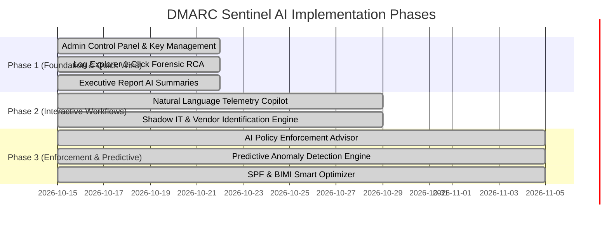

# DMARC Sentinel — AI Integration Roadmap & Technical Specification

This document outlines the proposed artificial intelligence and machine learning integration architecture for **DMARC Sentinel**. It specifies architectural options, feature blueprints, data pipelines, implementation phases, and security considerations.

---

## 1. Architectural Overview & Provider Support

To accommodate diverse deployment requirements (air-gapped SOCs, cloud-native deployments, and strict enterprise privacy policies), the AI integration layer is designed with a provider-agnostic abstraction:

```
┌─────────────────────────────────────────────────────────────┐
│                 DMARC Sentinel Frontend UI                  │
│       (Log Inspector RCA, Copilot Chat, Report Generator)   │
└──────────────────────────────┬──────────────────────────────┘
                               │
                               ▼
┌─────────────────────────────────────────────────────────────┐
│                 Express Backend AI Router                   │
│         (/api/ai/copilot, /api/ai/rca, /api/ai/summary)     │
└──────────────────────────────┬──────────────────────────────┘
                               │
            ┌──────────────────┴──────────────────┐
            ▼                                     ▼
┌──────────────────────────────┐    ┌──────────────────────────────┐
│       Cloud LLM Providers    │    │     Self-Hosted / Local LLM  │
│  (Google Gemini, OpenAI,     │    │  (Ollama, vLLM, LocalAI with │
│   Anthropic Claude)          │    │   Llama 3 / Mistral Nemo)    │
└──────────────────────────────┘    └──────────────────────────────┘
```

### Key Provider Options
1. **Cloud Hosted (Turnkey)**:
   * **Google Gemini API** (`gemini-1.5-flash`, `gemini-1.5-pro`, `gemini-2.0-flash`): High throughput, extensive context window for bulk raw report ingestion and longitudinal trend analysis.
   * **OpenAI** (`gpt-4o-mini`, `gpt-4o`, `gpt-3.5-turbo`): Standard enterprise JSON schema structured outputs and deterministic reasoning.
   * **Anthropic Claude** (`claude-3-5-sonnet-20241022`, `claude-3-5-haiku-20241022`): Precise forensic code analysis, nuanced RFC 7489 policy reasoning, and strict RFC adherence.
   * **OpenRouter** (`openrouter.ai` gateway): Multi-model unified gateway routing across 200+ foundation models with a single API key.
2. **Self-Hosted / Air-Gapped**:
   * **Ollama / vLLM / LocalAI**: Native OpenAI-compatible endpoint integration for on-premise security operations centers requiring zero external telemetry leakage (using `llama3.1:8b-instruct` or `mistral-nemo`).

### Admin Control Panel & Key Management
* **Location**: Super Admin Navigation → **AI Intelligence** ([`AiSettings.jsx`](file:///home/amr/dev/dmarc/web/client/src/components/AiSettings.jsx))
* **Master Control**: Master ON/OFF toggle switch to instantly enable or disable all AI telemetry processing application-wide.
* **Provider Switching**: Seamless 1-click switching between Google, OpenAI, Claude, OpenRouter, and Custom.
* **Security & Storage**: All API keys are encrypted at rest using **AES-256-GCM** with unique IVs in SQLite (`ai_settings` and `ai_provider_keys` tables). Keys are permanently masked (`••••••••`) in client-facing APIs.
* **Live Connection Test**: In-app "Test Connection" probe button with real-time latency feedback (`⚡ ms`) and validation diagnostics.

---

## 2. Core AI Capabilities & Feature Specifications

### 1. 🤖 AI Security Copilot ("Chat with Your DMARC Telemetry")
* **User Value**: Enables non-technical domain administrators and busy SOC analysts to query complex multi-million email logs using conversational language.
* **Capabilities**:
  * Formulates OpenSearch DSL queries automatically from user questions (e.g. *"Show me rogue IPs spoofing our finance subdomain over the last 14 days"*).
  * Synthesizes query results into visual summaries, trend explanations, and suggested remediation steps.
  * Context-aware of user domain permissions (enforces existing RBAC).
* **API Endpoint**: `POST /api/ai/copilot`
* **Input Payload**:
  ```json
  {
    "prompt": "Why did our delivery pass rate drop last Tuesday on voxera.net?",
    "domain_scope": "voxera.net",
    "time_window": "last_30_days"
  }
  ```

---

### 2. 📝 Automated Executive AI Narrative for Reports & Emails
* **User Value**: Replaces raw numbers and tables with an executive-ready security assessment suitable for C-suite briefings.
* **Capabilities**:
  * Injects a dynamic **"Executive Security Briefing"** paragraph at the top of PDF, Excel, and automated digest emails.
  * Highlights positive progress (e.g. alignment gains, authorized relay stability) and warns of active attack campaigns.
* **Example Generated Output**:
  > *"During October, 99.2% of corporate email traffic was fully compliant across 104,221 evaluated messages. However, an unauthorized cluster in ASN 16509 attempted to spoof the executive domain (`corp.example.com`) with 1,420 messages blocked by `p=reject`. Meanwhile, fresh marketing relay traffic exhibited alignment failures—we recommend adding DKIM selector `k1` to your DNS."*
* **Integration Points**:
  * [`reporting/engine/pdf_generator.py`](file:///home/amr/dev/dmarc/reporting/engine/pdf_generator.py)
  * [`reporting/engine/excel_generator.py`](file:///home/amr/dev/dmarc/reporting/engine/excel_generator.py)
  * [`web/server/workers/reportScheduler.js`](file:///home/amr/dev/dmarc/web/server/workers/reportScheduler.js)

---

### 3. 🔍 1-Click Root-Cause Analysis (RCA) in Log Explorer
* **User Value**: Eliminates manual cross-referencing of RFC alignment rules when investigating failed email deliveries.
* **Capabilities**:
  * In the **Document Inspector Modal** ([`RawLogExplorer.jsx`](file:///home/amr/dev/dmarc/web/client/src/components/RawLogExplorer.jsx)), an **"Analyze with AI"** button dissects the record:
    1. Compares RFC5322 `From` domain against SPF return-path and DKIM signing domains (`d=`).
    2. Identifies relaxed vs. strict alignment failures.
    3. Pinpoints whether failure is caused by an unlisted IP, missing selector, expired key, or forwarding relay rewrite.
    4. Provides ready-to-copy DNS records (SPF mechanism or DKIM CNAME) to authorize legitimate servers.
* **API Endpoint**: `POST /api/ai/diagnose-log`

---

### 4. 🏢 Shadow IT & Vendor Identification Engine
* **User Value**: Replaces cryptic IP addresses and reverse DNS names with human-readable SaaS vendor profiles.
* **Capabilities**:
  * Categorizes unknown sending sources (e.g., `mail-relay12.marketingvendor.com` or `198.2.138.10`) into recognized applications:
    * *ActiveCampaign, HubSpot, Salesforce Marketing Cloud, Freshdesk, Zendesk, Stripe, Workday*.
  * Labels whether sending sources represent Shadow IT (marketing/sales tools purchased without IT approval) vs. malicious spoofing.
  * Auto-generates vendor-specific DNS provisioning instructions.

---

### 5. 🛡️ AI Policy Enforcement Advisor ("What-If" Impact Simulator)
* **User Value**: Removes the fear of moving from `p=none` (monitoring) to `p=quarantine` or `p=reject`.
* **Capabilities**:
  * Simulates the exact impact of advancing DMARC enforcement:
    * *"Advancing to `p=reject` today will safely protect 99.4% of traffic. However, ~470 automated invoices from FreshBooks on `finance.company.com` will be blocked due to missing DKIM alignment."*
  * Computes a **Readiness Confidence Score (0–100%)**.
  * Provides a staged countdown and interactive checklist to safely reach `p=reject`.

---

### 6. 📈 Predictive Anomaly Detection (Beyond Static Thresholds)
* **User Value**: Detects "low-and-slow" phishing attacks and silent configuration drift that evade static percentage thresholds.
* **Capabilities**:
  * Unsupervised machine learning models (Isolation Forests, seasonal time-series decomposition):
    * Detects geographic shifts (e.g. an internal payroll domain suddenly transmitting from unusual ASNs).
    * Detects lookalike / typosquatted domains targeting the brand.
    * Flags unexpected drops in authorized volume (indicating an expired TLS certificate or broken cron job).

---

### 7. 🛠️ SPF & BIMI Smart Optimizer
* **User Value**: Prevents email delivery collapse caused by RFC 7208 10-lookup limits and BIMI SVG rendering rejections.
* **Capabilities**:
  * **SPF Flattener & Tree Pruner**: Detects redundant mechanisms, resolves deep `include:` chains, and generates optimized SPF TXT records within the 10-lookup budget.
  * **BIMI Validator**: Evaluates uploaded brand logos against strict SVG Tiny P/S requirements (checking XML namespaces, dimensions, square aspect ratio, and base64 VMC certificates).

---

## 3. Phased Implementation Roadmap



| Phase | Capabilities | Status | Target Deliverables | Impact |
| :--- | :--- | :--- | :--- | :--- |
| **Phase 1: Foundation & Quick Wins** | Admin Control Panel, 1-Click RCA in Log Explorer & Executive Report AI Summaries | **COMPLETED & LIVE** | Multi-provider LLM settings (Google, OpenAI, Claude, OpenRouter, Custom) with AES-256-GCM encryption; Log Explorer Document Inspector 1-Click RCA with copyable DNS remediation; Executive AI Security Briefing card in Reports with live synthesis, preview editing, and automated bundling into PDF (Page 1) and Excel (Sheet 1) | Instant forensic analysis without manual RFC inspection; full administrative control over LLM providers and keys; C-suite ready executive summaries |
| **Phase 2: Workflows** | Natural Language Copilot & Shadow IT Discovery | **COMPLETED & LIVE** | Floating drawer Telemetry Copilot grounded in live OpenSearch aggregates with multi-turn history, follow-up suggestion chips, and offline heuristic fallback; Shadow IT Discovery page with built-in 20+ SaaS catalog, at-risk volume metrics, and 1-Click "Authorize Vendor" DNS modal with copyable SPF and DKIM instructions | Eliminates OpenSearch DSL query friction; automatically discovers unsanctioned business apps sending corporate mail; accelerates 100% authentication |
| **Phase 3: Deep Security** | Policy Enforcement Simulator, Predictive Anomaly Engine & SPF/BIMI Optimizer | **COMPLETED & LIVE** | AI Policy Enforcement Advisor ("What-If" Simulator) with Readiness Confidence Score (0–100%), Safe Deliveries count, At-Risk Legitimate disruption breakdown, Neutralized threat projection, 5-stage transition roadmap checklist, and ready-to-deploy target DMARC DNS record generator; Predictive Anomaly Detection Radar spotting vendor drops, ASN/country spikes, and stealth spoof campaigns; SPF & BIMI Smart Optimizer evaluating RFC 7208 10-lookup limits and RFC 8953 BIMI SVG Tiny P/S readiness | Direct, safe driver for transitioning domains from `p=none` to 100% `p=reject` with zero business communication disruption; protects against stealth phishing campaigns and DNS PermErrors |

---

## 4. Privacy, Security & Compliance Safeguards

1. **Zero Data Retention (ZDR)**:
   * When integrating cloud APIs, ensure enterprise zero-data-retention agreements are active so customer telemetry is never used for foundation model training.
2. **PII Masking & Redaction**:
   * Pre-processing sanitizes sensitive recipient email addresses before dispatching payloads to the AI model.
3. **Local/On-Premise Fallback**:
   * Organizations with strict data residency mandates can select `provider: "ollama"` to execute all inference on local GPU/CPU hardware.
