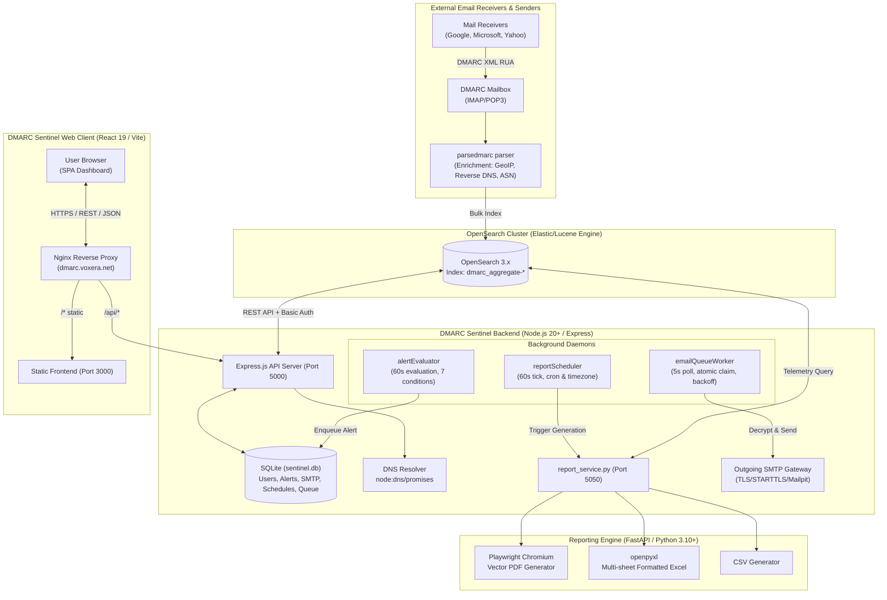
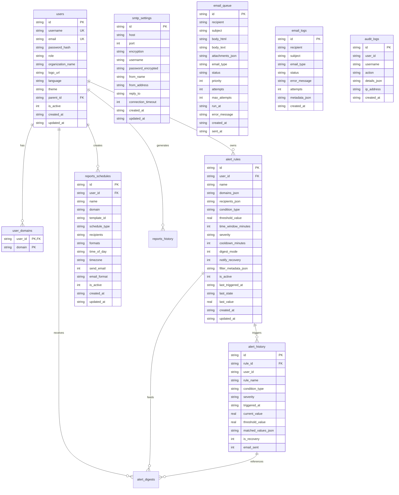

# DMARC Sentinel: System Architecture & Technical Design

This document details the complete end-to-end architecture, data flows, database schema, security model, and component hierarchy of **DMARC Sentinel**.

---

## 1. High-Level System Architecture

DMARC Sentinel is an enterprise-grade email authentication monitoring, forensics, and reporting platform. It ingests parsed DMARC XML reports from mail receivers, enriches sender data with DNS and GeoIP metadata, indexes telemetry into OpenSearch, and provides real-time analytics, automated alerting, and multi-format PDF/Excel reports via a web application.



---

## 2. Core Components Walkthrough

### 2.1 Ingestion & Telemetry Pipeline
1. **DMARC XML Reports**: Mail transfer agents (Google, Microsoft 365, Yahoo, Fastmail, etc.) generate daily aggregate DMARC reports (`.xml.gz` or `.zip`) according to RFC 7489.
2. **Parser & Enrichment (`parsedmarc`)**: Fetches incoming reports from IMAP/POP3, decompresses XML payloads, extracts records, and queries MaxMind GeoIP and DNS PTR records for geographic and network attribution.
3. **OpenSearch Storage**: Telemetry is indexed into daily partitioned indices (`dmarc_aggregate-YYYY-MM-DD`). Every record encapsulates `date_begin`, `header_from`, `source_ip_address`, `message_count`, `disposition`, and SPF/DKIM authentication outcomes.

---

### 2.2 Backend API Service (`web/server`)
The backend is a high-concurrency Node.js application built with Express.js:
* **Proxy & Aggregation**: Queries OpenSearch using Elasticsearch/Lucene JSON query DSL, translating multi-level aggregations into clean, typed frontend data contracts.
* **Domain Access Enforcement**: Role-based access control middleware (`enforceDomainAccess`) verifies user tenancy on every query, preventing unauthorized data access.
* **DNS Protocol Inspection**: Implements live recursive DNS resolution for SPF lookup counting, DMARC validation, DKIM selector checks, BIMI discovery, MTA-STS, TLS-RPT, and DNSSEC.
* **State Management**: Persists users, alert rules, incident history, SMTP gateway configuration, audit logs, and scheduled reports in an embedded SQLite database using `better-sqlite3`.

---

### 2.3 Background Workers
The backend initializes three independent background workers:

```
┌────────────────────────────────────────────────────────────────────────┐
│                        BACKGROUND DAEMONS                              │
├──────────────────────┬────────────────────────┬────────────────────────┤
│  emailQueueWorker    │     alertEvaluator     │    reportScheduler     │
├──────────────────────┼────────────────────────┼────────────────────────┤
│ • Polls every 5s     │ • Evaluates every 60s  │ • Ticks every 60s      │
│ • Atomic DB claims   │ • 7 security rules     │ • Timezone calculation │
│ • Exp backoff retry  │ • Cooldown suppression │ • Triggers Python API  │
│ • Rate limit: 20/hr  │ • Recovery detections  │ • Enqueues attachments │
│ • Sliding dedup 15m  │ • Staged daily digests │ • Audit logging        │
└──────────────────────┴────────────────────────┴────────────────────────┘
```

1. **`emailQueueWorker.js`**:
   - Polling interval: 5 seconds.
   - Transactionally queries `email_queue` for records where `status = 'pending' AND run_at <= datetime('now')`.
   - Claims records atomically using SQLite transactions: `UPDATE email_queue SET status='processing' WHERE id IN (...)`.
   - Decrypts SMTP credentials via AES-256-GCM and dispatches via Nodemailer.
   - On delivery failure, increments attempt count and applies exponential backoff (`run_at` rescheduled +2m, +10m) up to 3 attempts.
   - Recipient rate-limiting prevents mail server blacklisting (max 20 emails/hour per recipient).
2. **`alertEvaluator.js`**:
   - Interval: 60 seconds.
   - Queries all active alert rules from `alert_rules`.
   - Pulls real-time metrics from OpenSearch across the rule's specific `time_window_minutes`.
   - Evaluates rule threshold against current value.
   - If triggered and outside cooldown window:
     - Creates record in `alert_history`.
     - Generates responsive HTML email notification using `alert_notification.html`.
     - Inserts notification into `email_queue`.
   - If previously triggered and metric returns to normal:
     - Dispatches "All Clear / Recovery" notification if `notify_recovery = 1`.
3. **`reportScheduler.js`**:
   - Interval: 60 seconds.
   - Reads active schedules from `reports_schedules`.
   - Converts current server UTC time into the user's specific target timezone using `Intl.DateTimeFormat`.
   - Checks matching time of day (e.g., `08:00`) and frequency (daily, weekly on Monday, monthly on 1st).
   - Spawns report generation via Python service or direct script execution.
   - Enqueues delivery email with attached PDF, Excel, and CSV files.

---

### 2.4 Enterprise Reporting Engine (`reporting/`)
A standalone Python microservice built with FastAPI:
* **Vector PDF Generator (`pdf_generator.py`)**: Uses Playwright Chromium headless browser to render pixel-perfect executive reports with dynamic vector charts, executive summaries, and high-contrast tables.
* **Multi-Sheet Formatted Excel Generator (`excel_generator.py`)**: Uses `openpyxl` to build enterprise workbooks containing:
  * Executive Overview tab with embedded corporate logos.
  * Compliance Breakdown tab with conditional formatting.
  * Detailed Origin Logs tab with frozen header rows and auto-adjusted column widths.
* **CSV Generator (`csv_generator.py`)**: Exports raw, unaggregated record logs in UTF-8 formatted comma-separated values.
* **Template Engine (`templates/`)**: JSON-based template definitions enabling white-label branding, customized color schemes, localized typography, and multilingual text.

---

### 2.5 Modern Frontend Web Client (`web/client`)
A Single Page Application (SPA) built with React 19, Vite, Tailwind CSS v4, and Recharts:
* **Modular Tab Architecture**:
  * `overview`: High-level executive KPI grid, traffic timeseries, 4-way alignment matrix, top senders.
  * `health`: PowerDMARC-style live DNS protocol inspector (SPF lookup counter, DMARC tags, DKIM selector, BIMI, MTA-STS, TLS-RPT, DNSSEC).
  * `alignment`: SPF and DKIM pass/fail donuts and override tracking.
  * `threats`: SOC threat feed, attacker ASN ranking, geographic breakdown, containment stats.
  * `alerts`: User alerting rules, dry-run testing engine, incident history.
  * `policies`: DMARC policy enforcement distribution and readiness calculator.
  * `reports`: Leaflet GIS world map with Esri Canvas/OSM/Satellite layers, on-demand report generation, template manager, and scheduled deliveries.
  * `records`: Searchable raw DMARC aggregate records with JSON inspector.
  * `users`: User access management (admin/manager/viewer roles, domain assignments).
  * `smtp`: Outgoing SMTP settings with live 3-step socket diagnostics modal, queue inspector, and delivery logs.
* **Internationalization (i18n)**: English (`en`), Arabic (`ar` with RTL layout support), French (`fr`), Spanish (`es`).
* **Theme System**: 5 curated themes (Sentinel Dark, Nordic Frost, Emerald Security, Cyberpunk Neon, Light Mode).

---

## 3. Database Schema & Entity Relationships

The backend utilizes SQLite (`web/server/data/sentinel.db`) with `PRAGMA foreign_keys = ON`:



---

## 4. OpenSearch Schema & Data Dictionary

All string fields use the `.keyword` sub-field for aggregations. All volume metrics strictly compute `sum(message_count)`:

| Field Name | Type | Purpose | Aggregation Role |
| :--- | :--- | :--- | :--- |
| `date_begin` | `date` | Report interval start | Date histogram primary time field |
| `date_end` | `date` | Report interval end | Time range bounds |
| `header_from` | `text` (`.keyword`) | RFC 5322 From Domain | Primary domain segmentation |
| `source_ip_address` | `text` (`.keyword`) | Sending mail server IP | Source IP breakdown and threat analysis |
| `source_country` | `text` (`.keyword`) | ISO 3166-1 alpha-2 code | Geographic traffic distribution |
| `source_asn` | `long` | Autonomous System Number | Network attribution |
| `source_as_name` | `text` (`.keyword`) | ISP / Hosting provider | Cloud / ISP classification |
| `source_base_domain`| `text` (`.keyword`) | Provider base domain | Sender inventory (Google, Microsoft, etc.) |
| `source_name` | `text` (`.keyword`) | Sender service label | User-friendly sender classification |
| `source_reverse_dns`| `text` (`.keyword`) | PTR DNS record | Mail server hostname verification |
| `message_count` | `long` | Message count in report | **Weight metric for all calculations** |
| `disposition` | `text` (`.keyword`) | Applied policy action | Breakdown: `none`, `quarantine`, `reject` |
| `passed_dmarc` | `boolean` | DMARC pass/fail result | Compliance rate numerator |
| `spf_aligned` | `boolean` | RFC 5321 alignment | SPF authentication compliance |
| `dkim_aligned` | `boolean` | RFC 6376 alignment | DKIM authentication compliance |
| `dkim_results.selector`| `text` (`.keyword`)| DKIM selector tag | Key rotation and selector tracking |
| `policy_overrides.type`| `text` (`.keyword`)| Policy override reason | Forwarding and mailing list identification |
| `published_policy.p`| `text` (`.keyword`) | Published domain policy| Policy state (`none`, `quarantine`, `reject`)|
| `published_policy.pct`| `long` | Enforcement percentage | Enforcement rollout tracker (0-100) |

---

## 5. Security Architecture & Threat Defenses

```
┌────────────────────────────────────────────────────────────────────────┐
│                        SECURITY CONTROLS                               │
├────────────────────────────────┬───────────────────────────────────────┤
│ Threat Vector                  │ Implemented Mitigation                │
├────────────────────────────────┼───────────────────────────────────────┤
│ Credential Theft at Rest       │ AES-256-GCM authenticated encryption  │
│ Password Cracking              │ bcrypt hashing with high salt rounds  │
│ Session Hijacking              │ Signed JWT with expiry & Bearer check │
│ Brute-Force Authentication     │ Express rate-limit on /api/auth/login │
│ Server-Side Request Forgery    │ Strict FQDN regex; IP & port blocking │
│ Path Traversal                 │ path.basename() sandbox restriction   │
│ Cross-Origin Resource Sharing  │ Dynamic host & proxy origin validator │
│ Header Injection (CRLF)        │ Strips \r and \n from email headers   │
│ Cross-Site Scripting (XSS)     │ Helmet security headers, CSP, nosniff │
│ Denial of Service (Spamming)   │ Recipient rate-limiting (20/hr/rcpt)  │
└────────────────────────────────┴───────────────────────────────────────┘
```

1. **AES-256-GCM Authenticated Encryption**:
   - Master key derived from `SMTP_ENCRYPTION_KEY` using SHA-256.
   - Every encryption operation generates a cryptographically random 12-byte initialization vector (IV).
   - Employs a 16-byte authentication tag to detect any tampering or ciphertext corruption.
   - Plaintext passwords never leave the database; API endpoints mask secrets as `••••••••`.
2. **SSRF Mitigation in Domain Health**:
   - Endpoint `/api/domain-health` strictly validates domain inputs against RFC 1123 hostname rules:
     `^([a-zA-Z0-9]([a-zA-Z0-9-]{0,61}[a-zA-Z0-9])?\.)+[a-zA-Z]{2,}$`
   - Automatically rejects raw IPv4/IPv6 addresses, URLs (`http://`), port specifications (`:8080`), path traversal characters, and cloud metadata IPs (`169.254.169.254`).
3. **Path Traversal Defense in File Downloads**:
   - Downloads on `/api/reports/download/:filename` strip directory prefixes using `path.basename()`.
   - Resolves files strictly within the sanitized `reporting/output` directory.
